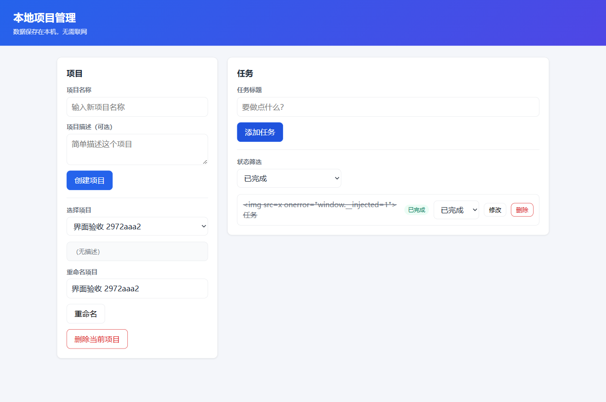

# 本機專案管理應用驗收

[简体中文](PROJECT_BENCHMARK.zh-CN.md) · [English](PROJECT_BENCHMARK.en.md)

2026-10-15：0.1.8 ZIP 的真實 Kimi K3 自動完成三輪開發，交付 13 個檔案及 14 項通過測試。獨立 API、SQLite 重啟、瀏覽器建立/編輯/刪除/篩選及窄螢幕檢查均通過，見 [機器記錄](acceptance/real-project-manager-2026-10-15.json)。前三次瀏覽器檢查缺少 Chromium，之後改用既有 Edge 通過；保留環境失敗紀錄，沒有把它當成應用缺陷。原設定不變且臨時憑據已移除。原始碼 ZIP 位於 `release/Kuade-generated-project-manager-2026-10-15.zip`，解壓後進入 workspace 執行 `npm test` 或 `npm start`。

使用者選定專案、任務、持久化、篩選、測試與介面作為多模組開發驗收。真實模型透過獨立使用者目錄中的 Kuade 0.1.8，從空工作區分輪完成後端、介面、測試與修復。宿主只提供需求及外部檢查，不撰寫應用實作；通過此基準不代表任意大型專案都能成功。

契約位於 `scripts/acceptance/project-manager-spec.mjs`。沿用 Node 22.23.2 內建 HTTP、SQLite、測試框架及既有 Playwright。該版 SQLite API 仍屬實驗性，本次固定執行環境並已實測建庫查詢；沒有新增產品依賴。參考 [Node SQLite](https://nodejs.org/api/sqlite.html) 與 [Playwright 啟動](https://playwright.dev/docs/api/class-browsertype#browser-type-launch)。原生介面僅用於基準，Kuade 仍使用 React/Electron。

外部檢查涵蓋 HTTP CRUD、輸入驗證、組合篩選、缺失物件、SQLite 格式、程序重啟持久化、刪除級聯，以及瀏覽器建立專案/任務、切換狀態、篩選、重新整理、文字跳脫與窄螢幕。模型須交付及執行非空測試。失敗回饋至同一會話，最多三次驗收且保留每次記錄；觀察時限到達記為未完成，不算產品功能失敗。

在已安裝依賴的建置目錄設定 `KUADE_REAL_PROJECT=1`、`KUADE_MODEL_PROFILE`、`KUADE_ACCEPT_EXECUTABLE`，執行 `node E:/Kuade-Hermes/scripts/accept-real-project.mjs`。可用 `KUADE_ACCEPT_ROOT` 指定證據位置。結束後移除隔離憑據並比對原設定雜湊；保留原始碼、資料庫、測試、截圖與修復紀錄。證據含本機資料與模型會話，請勿整份直接上傳。

以最終獨立檢查回執為準，執行中或模型自報完成不代表通過。原 `acceptance.json` 保留環境失敗，Edge 重驗另存並由機器記錄彙整。另行兩小時測試涵蓋長命令與重啟生命週期，不計入本專案開發時長。驗收器已加入瀏覽器預檢，環境缺失不再作為應用修復任務；預設 Edge，可用 `KUADE_ACCEPT_BROWSER_CHANNEL` 選擇其他已安裝通道。
