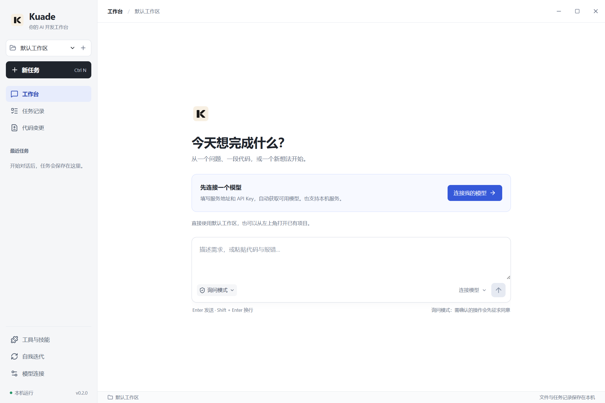
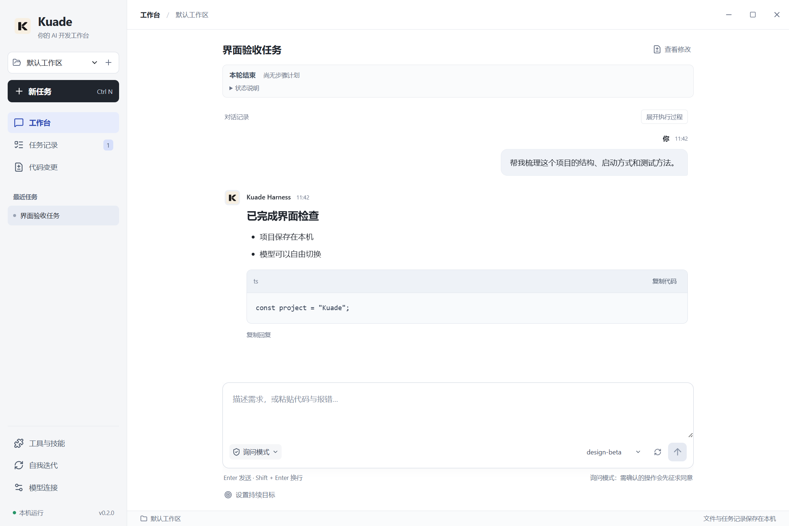
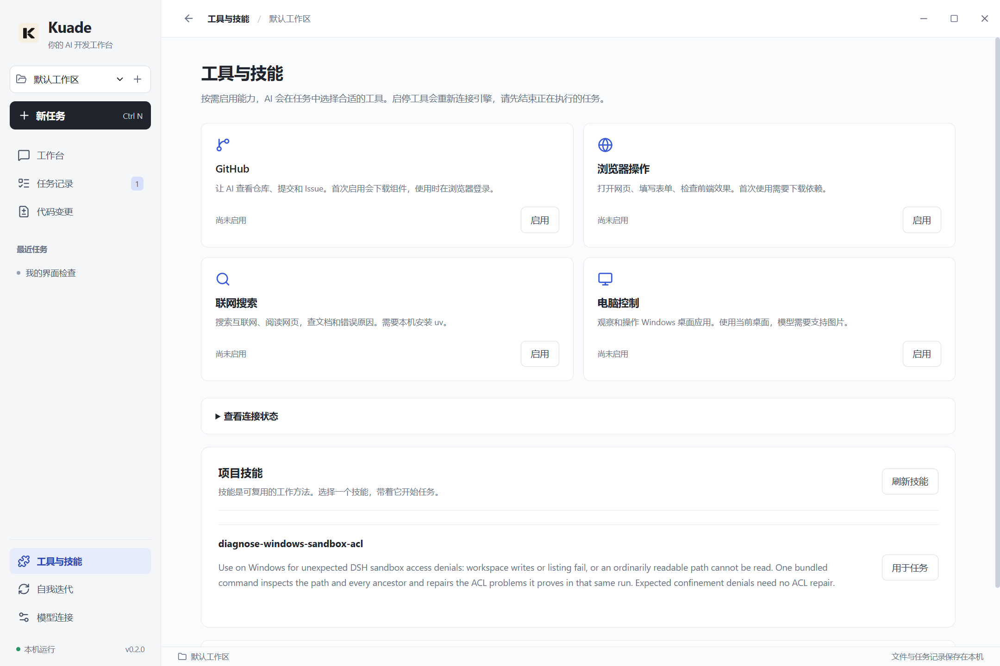

# Kuade 0.2.0 界面重构

默认文档为简体中文。[繁體中文](UI_REDESIGN.zh-TW.md) · [English](UI_REDESIGN.en.md)

## 从用户任务出发

旧界面把连接、工具配置和执行细节同时展示，用户需要先理解内部机制才能开始。此次围绕“连接模型 → 描述需求 → 查看结果 → 必要时检查执行过程”重排全部六个页面，保留现有 Harness 执行层。

| 页面 | 现在的操作 |
| --- | --- |
| 工作台 | 首次使用直接连接模型；选择示例后编辑需求；模型按服务分组放在同一个选择器；无需选择目录即可使用默认工作区 |
| 对话输出 | 正常文字、标题、代码与表格分别排版；连续工具记录默认折叠；可展开原始详情、复制代码或完整回复；阅读历史时保留滚动位置 |
| 任务记录 | 搜索、筛选、重命名，最近任务常驻侧栏 |
| 代码变更 | 文件名与恢复按钮分开；恢复前明确确认；保留实际 Git Diff 与过期变更保护 |
| 模型连接 | 自动获取列表、搜索、批量选择；保存后“开始对话”；高级容量配置折叠 |
| 工具与技能 | 四种常用能力直接启停并保存；技能直接用于任务；连接状态与自定义 MCP 配置按需展开 |
| 自我迭代 | 明确源码、需求、独立测试、更新重启三个阶段；保留进度、停止和重试 |

## 视觉与模块

统一白色内容区、灰色侧栏、蓝色操作强调、13–14px 基础文字和清晰的焦点样式；移除装饰性大图与拥挤标签。适配 1440×960 与 1000×760 桌面窗口。导航、欢迎页、输出分组独立成模块，业务状态仍由现有工作区及 Harness 管理。

工具开关表示配置启用，不代表实际握手成功；连接状态仍以运行时结果为准。高级 MCP 草稿有未保存改动时暂时禁用快捷开关，防止静默覆盖。保存被拒绝时保留原设置；若保存成功但重连失败，则重新读取配置并明确说明连接未完成。

## 验证范围

本次使用隔离用户目录和本机受控模型服务，检查真实 Electron、Harness、文件系统、剪贴板、MCP 以及持久化链路。它验证界面交互和集成，不替代真实外部模型质量、跨天执行或自更新的历史专项验收。具体结果和截图见 `docs/acceptance/ui-redesign-0.2.0-2026-10-22.json`。

已通过：154 项自动化检查（132 项应用测试与 22 项验收脚本测试）、类型检查、生产构建、7 条开发版桌面流程和独立 ZIP 的 3 条桌面流程。ZIP 完整性与复制后的 SHA-256 一致性检查通过。交付版本 0.2.0，未签名；本轮提供便携 ZIP，未生成新安装器。

## 参考来源 / References

- [Cursor Agent](https://prod.cursor.com/help/ai-features/agent) 和 [Review](https://docs.cursor.com/en/agent/review)：任务与代码审查放在主流程。
- [Claude Code Desktop redesign](https://claude.com/resources/articles/claude-code-desktop-redesign)：任务导航与输出层级。
- [VS Code tools](https://code.visualstudio.com/docs/agents/run/tools)：工具能力与执行状态分开呈现。
- [Linear UI refresh](https://linear.app/changelog/2026-03-12-ui-refresh)：统一导航、标题和控件层级。
- [NN/g Progressive disclosure](https://www.nngroup.com/articles/progressive-disclosure/)：高级信息按需展开。

参考交互原则，未引入这些产品的代码、图标或品牌资产。

## 界面截图

以下为隔离验收环境中的真实桌面截图，模型与项目数据为测试样例。

