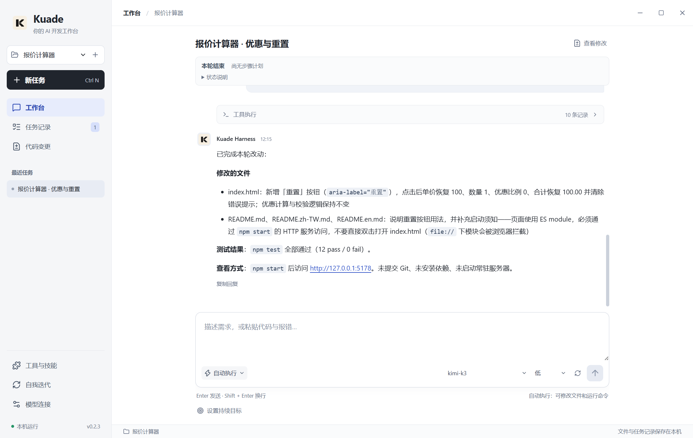
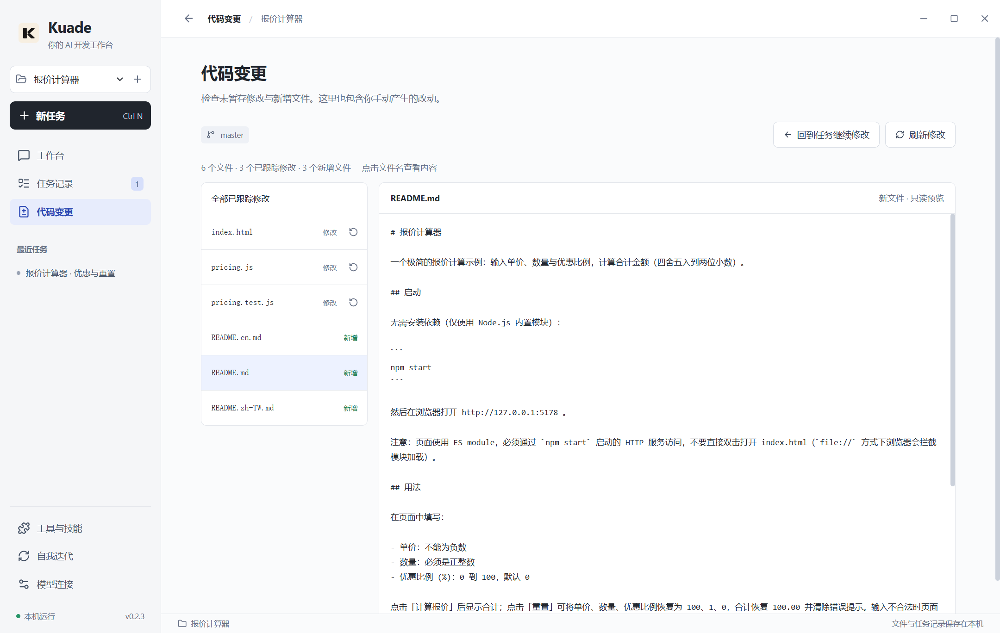

# Kuade 0.2.3 使用者完整流程驗收

[简体中文](USER_JOURNEY.zh-CN.md) · [English](USER_JOURNEY.en.md)

## 本輪改善

- 回覆中以行內程式碼顯示的網址也能點擊開啟；命令與多行程式碼保持原樣。

- 新工作首頁明確顯示目前專案，避免選擇專案後仍被提示使用預設工作區。
- 「程式碼變更」將檔案列表放在預覽旁，點擊檔名即可查看單一檔案的 Diff。
- 新增檔案可直接預覽，並提供空檔、二進位、編碼與大型檔案提示。
- 提供「回到工作繼續修改」，保留原工作脈絡。
- 尚未啟用 Git 時說明原因與下一步，不直接展示底層命令錯誤。

內容預覽為唯讀。還原仍需要明確確認與過期 Diff 檢查；新增檔案沒有刪除或還原按鈕。檔案預覽沿用 Git 與檔案系統介面。網址辨識使用 [linkify-it 6.1.0](https://github.com/markdown-it/linkify-it)（MIT），支援緊鄰中文的地址；執行引擎保持原樣。

## 真實模型流程

使用隔離 Windows 設定與使用者已儲存的 Kimi K3 連線。模型回應並非測試替身。驗收器只建立報價計算器初始專案，優惠與重設功能由模型開發。

開啟專案、新建工作、選擇模型與自動模式 → 開發優惠、驗證、測試與文件 → 檢查 Diff 與新增檔案 → 重新命名、搜尋並重新開啟工作 → 請模型加入重設功能 → 獨立測試計算邏輯與非法輸入，在 Edge 驗證結果及重設 → 重啟桌面端並讀取歷史。

初輪模型曾建議直接雙擊使用 ES module 的 HTML；後續流程反饋此問題，要求改用本機 HTTP 服務。說明文字與實際執行結果分開核對。

## 證據與邊界

詳見 `docs/acceptance/real-user-journey-0.2.3-2026-10-22.json`，包含初輪、更新後版本、測試數量、截圖與原始證據路徑。

測試僅為檔案選擇器提供確定路徑，其餘工作流程使用真實介面。產出應用透過隔離 HTTP 服務在 Edge 執行，不將系統預設瀏覽器啟動算為通過。本輪是兩輪報價計算器與持久化驗收，不替代大型專案、跨日執行、電腦控制或自更新驗收。

臨時設定與憑據在測試結束後刪除，雜湊驗證原設定未變；證據不記錄密鑰。提供 Windows 便攜 ZIP，未重新產生安裝程式。

## 本輪結果

142 項應用測試、22 項驗收腳本測試、型別檢查、正式建置與桌面互動檢查通過。最近一次完整的兩輪真實 Kimi K3 開發在 0.2.2 通過；交付版 0.2.3 補正網址辨識，以相同真實工作回放驗證，沒有再次送出開發請求。產出專案的 12 項測試再次通過；Edge 中優惠合計為 53.97，重設後為 100.00。

最終版也檢查新檔預覽、逐檔 Diff、窄視窗、返回工作與重啟後繼續輸入。網址點擊驗證主程序分發，系統瀏覽器開啟器由測試替身接收；實際頁面功能另外在 Edge 驗證。

